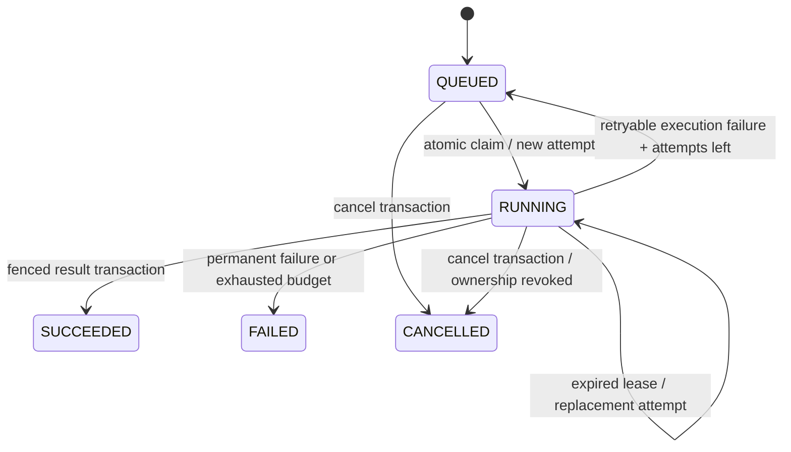

# Milestone 3: durable execution and the runnable mock

Status: implementation provided; mock/worker verification passed. **PostgreSQL concurrency, migration execution and process-failure recovery remain unverified.** When Docker access was denied and no database was installed, the user requested the mock. Mock success is not used as evidence for database guarantees.

## Acceptance criteria established before implementation

| Observable requirement | Verification supplied | Current evidence |
| --- | --- | --- |
| Concurrent submission keys resolve to one job; conflicting settings reject | Shared store contract | Mock passed; PostgreSQL pending |
| Workers atomically claim different live attempts and skip locked rows | Contract plus PostgreSQL row-lock test | Mock policy passed; SQL claim pending |
| Each claim creates a distinct bounded attempt with a monotonic fence | Store contract | Mock passed; PostgreSQL pending |
| Expired leases recover; expired owners cannot renew, finish or reschedule | Store contract and lock-wait expiry test | Mock passed; PostgreSQL pending |
| Retries respect attempt limits and delayed eligibility | Store contract and worker tests | Mock passed; PostgreSQL pending |
| Result and terminal state persist together; repeated completion cannot overwrite | Contract plus transaction-rollback test | Mock policy passed; database atomicity pending |
| Completion/cancellation produce one terminal state | 20 contract races | Mock passed; PostgreSQL pending |
| Active work has a fixed bound and no prefetched in-memory job queue | Worker latches and state observations | Passed against mock |
| Shutdown and lease loss interrupt cooperative work without publishing stale results | Worker tests, including swallowed interruption and uncertain commit | Passed against mock |
| Killing/restarting a process produces a replacement attempt and one persisted result | Recovery script plus process integration test | Implemented, not run |

## Three different lifetimes

- **Job:** durable intent identified by a UUID and a unique submission key, containing a synthetic scenario, per-attempt investigation budget and maximum attempts.
- **Execution attempt:** one claimed lease, worker identity and monotonically increasing number. A retry or replacement worker gets a new number; the old number cannot authorize a new persisted effect.
- **Child task:** an in-process evidence call or LLM attempt from the previous milestones. It is not separately persisted or claimed. External child work may be repeated if its durable attempt is retried.

A queued job's investigation budget starts when its handler executes, not at submission. Queue delay and durable retry delay do not consume that per-attempt budget. The original evidence investigation still has one overall deadline; synthesis uses its remaining time. There is no job-wide wall-clock expiry yet.

## Components and ownership

```text
jobs submit/status/cancel/migrate
            │
         JobStore boundary
            ├── PostgresJobStore → HikariCP → PostgreSQL tables + Flyway history
            └── InMemoryJobStore → monitor-protected mock, lost on exit

fixed number of virtual JobWorkers
   └── claim one job when free (no prefetch)
       ├── heartbeat for that actual attempt
       └── InvestigationJobHandler
           ├── shared bounded ToolRuntime
           └── shared provider-specific LlmGateway (deterministic fake)
       └── stop/join heartbeat, then fenced result or failure transaction
```

The process owns its workers, tool runtime and connection pool. Each worker owns one handler execution at a time and at most one heartbeat thread. It never detaches heartbeat I/O and starts another job: after handler completion it interrupts and joins that heartbeat. A database driver that ignores cancellation can therefore retain a worker; bounded shutdown reports incomplete termination rather than inventing cleanup.

Default settings are 2 workers, 10-second leases, 2-second heartbeats, 200ms idle/error polling, 1-second durable retry delay and 5-second shutdown grace. Configuration is immutable, supports 1–32 workers and requires a lease of at least three heartbeat intervals. The application uses an 8-connection Hikari pool; connection acquisition, JDBC query/lock and transport waits have finite timeouts. No transaction stays open across handler, tool, provider or backoff work. The fixed poll delay avoids database outage spin loops; it is not a unit-test correctness sleep.

Only free workers claim. Persistent backlog stays in PostgreSQL, not an executor queue. Worker and tool bounds are per process, not a cluster-wide execution limit. Queue storage itself has no submission-count cap or retention policy yet. The mock holds its backlog in memory and is for demonstrations/tests only.

## Database representation

`V1__durable_jobs.sql` creates:

| Table | Purpose / constraints |
| --- | --- |
| `investigation_job` | Job UUID; unique submission key; immutable scenario/settings; bounded attempt counter; state; availability; current worker and lease |
| `investigation_attempt` | Primary key `(job_id, number)`; worker identity, start/finish, state and safe failure code |
| `investigation_result` | Primary key `job_id`; attempt foreign key and bounded report text; immutable final persisted effect |

Ready and expired-running jobs have partial indexes. PostgreSQL `TIMESTAMPTZ` and `clock_timestamp()` own lease and retry time; JVM clocks do not decide ownership. This avoids cross-worker clock skew, but database wall-clock jumps can still affect lease duration. Flyway owns migration history/checksums and schema creation. Migrations run explicitly with `jobs migrate` before workers start; the application does not implement its own migration framework.

A submission key is scoped to its database schema. Reusing it with the same settings returns the original job UUID, including after terminal completion; different settings reject. PostgreSQL uses a unique constraint and `INSERT ... ON CONFLICT DO NOTHING`, then a fresh READ COMMITTED query to see the winner. The mock uses a synchronized map and does not model SQL visibility.

## Claim and fenced writes

A short READ COMMITTED transaction selects one eligible row using `FOR UPDATE SKIP LOCKED`:

1. Choose a due `QUEUED` job or expired `RUNNING` job.
2. Mark an old expired attempt `EXPIRED`, if present.
3. If no attempt budget remains, mark the job `FAILED` with `ATTEMPTS_EXHAUSTED`; execute no new handler.
4. Otherwise increment the attempt counter, insert the attempt, record the worker and set a new lease in the same transaction.

There is no separate reaper process. Claiming performs bounded recovery maintenance. A claim call that finalizes an exhausted job may return empty even when more jobs exist; workers poll again.

Renewal, failure and completion first lock the job row, validate current attempt/worker/settings, then execute a **new guarded update** checking `lease_until > clock_timestamp()`. The fresh statement matters: checking a lease before waiting on a row lock could authorize an already expired worker. Neither an expired unreclaimed owner nor a replaced owner can revive its lease or persist an effect. Cancellation uses the same job-row serialization.

Successful completion updates the job, inserts its unique result, and finishes the attempt in one transaction. Repeating the same attempt/worker/body returns success without another insert. A different body or older attempt returns false and cannot overwrite anything. Failure and cancellation update their attempt history in the same transaction. All transitions acquire job before attempt/result locks.

If commit acknowledgement is lost, the worker cannot know whether the transaction committed. It does not issue an unfenced fallback update or automatically mark the job failed. A committed terminal state stays terminal; an uncommitted attempt remains leased and becomes eligible for recovery after expiry. Mock tests model both possibilities, but do not prove PostgreSQL rollback/commit behavior.

## State transitions and cancellation



Queued cancellation is immediately terminal and uses no attempt. Running cancellation is also immediately terminal in the store: it marks the current attempt cancelled and clears worker/lease ownership. The local worker notices through renewal failure and interrupts its handler. It may have already performed external calls, and uncooperative work may continue. Any later persisted result is fenced out. If completion commits first, cancellation returns false and the result remains; if cancellation commits first, completion returns false.

A handler report is not the job state. `SUCCEEDED` means the report was committed; that report can contain an investigation state of `FAILED`, `PARTIAL` or `TIMED_OUT`. Those are useful investigation outcomes, not reasons to rerun every evidence call. Durable execution retries require an explicitly retryable `JobHandler.Failure`; unknown/programming failures are permanent. Shutdown/interruption consumes the already-started attempt and reschedules only if budget remains.

## Graceful shutdown and uncertainty

Shutdown stops claiming, stops further scheduled renewals, interrupts workers, and joins them within one total grace budget. A renewal already in progress may finish. Cooperative workers clean up, stop/join their heartbeat and use a still-valid fence to reschedule with `SHUTDOWN` (or fail if attempts are exhausted). If ownership has already been lost, they publish no state change. Queued jobs remain queued.

A timed-out shutdown returns false; `close()` requests the same bounded shutdown without throwing away active thread accounting. A stuck handler can outlive it. Once renewal stops, its lease can expire and another process may execute the job while the old external work still runs. Only the database effect is fenced; arbitrary external operations are not.

Heartbeat errors are treated as uncertain ownership, set a separate atomic loss flag and interrupt the owner. That flag survives a handler swallowing interruption and returning a value. The attempt is left for lease recovery. Event logging exposes only kind/job UUID/attempt; safe failure codes are persisted instead of arbitrary exception messages. The worker consumes interruption at its own reusable execution boundary after translating it into a durable outcome.

## At-least-once, with bounded attempts

Execution may repeat after a crash, expired lease, explicit retry or uncertain commit. Attempt budgets can eventually stop retrying without a result. Neither the primary key on results nor fencing prevents repeating an external provider call. For example, a process can finish synthesis, die before commit, and run synthesis again after recovery. One persisted report and two billed calls are entirely consistent with this design. No exactly-once external execution is promised.

## Run modes

Default, no database or driver required:

```sh
./mvnw verify
java -jar target/agent-runtime-java-0.1.0-SNAPSHOT.jar jobs mock-demo
```

The mock demo runs healthy and partial jobs, then prints a queued cancellation with zero attempts. All data disappears on JVM exit.

For real PostgreSQL (unverified here):

```sh
docker compose up -d --wait
./mvnw -Ppostgres clean package
export RELEASE_DB_URL=jdbc:postgresql://localhost:55432/investigator
export RELEASE_DB_USER=investigator
export RELEASE_DB_PASSWORD=local-demo-only
java -jar target/agent-runtime-java-0.1.0-SNAPSHOT.jar jobs migrate
java -jar target/agent-runtime-java-0.1.0-SNAPSHOT.jar jobs submit checkout-v42 healthy 20000 3
java -jar target/agent-runtime-java-0.1.0-SNAPSHOT.jar jobs work
```

`submit <key> [scenario] [budget-ms] [max-attempts]` supports the four existing scenarios. Use `jobs status <uuid>` and `jobs cancel <uuid>` in a second terminal. Workers continue until shutdown. Defaults match [.env.example](../../.env.example); environment files must be sourced/exported explicitly. Keep credentials in environment variables, separate from the JDBC URL. `RELEASE_DB_SCHEMA` defaults to `release_investigator`. The Compose image is pinned to `postgres:17.6-bookworm`, with loopback-only port 55432 and a named persistent volume. `docker compose down` preserves that volume; deleting it deletes local demo data.

The `postgres` build profile adds pgJDBC 42.7.14. The cached older driver was not selected for the real path. A default mock artifact gives an explicit build-profile error for database commands. Flyway 11.7.2, HikariCP 6.3.3, SLF4J 2.0.18 and Jackson BOM 2.21.4 are pinned documented cached releases, not claims of latest versions. The shaded executable merges service descriptors and license/notice resources. It remains one application artifact; no extra service was added beyond PostgreSQL.

## Real verification commands and recovery demonstration

Requires a dedicated PostgreSQL database and JDK 25:

```sh
./mvnw -Ppostgres,postgres-it clean verify
python3 scripts/demo_recovery.py
```

The opt-in integration suite includes the shared store contract, a locked-row skip test, lease expiry after a lock wait, atomic rollback on result-insertion failure, migration repeatability/result uniqueness, and a subprocess kill/restart test. It requires `RELEASE_DB_URL`; absence fails the explicit suite rather than counting database checks as skipped success. Tests create/drop only generated `it_...`/`recovery_it_...` schemas. Python 3 is required for the subprocess demo.

The standalone recovery script uses its own generated schema, migrates it, submits one job, starts `work --pause-before-commit`, observes `EXECUTED <uuid> attempt=1`, kills that process, starts a normal worker, waits for actual lease expiry, and checks attempt 1 `EXPIRED`, attempt 2 `SUCCEEDED`, and one result. The integration wrapper additionally counts persisted result rows in SQL. Script loops have bounds; process-observation polling is not used to assert timing-based concurrency correctness. The standalone script leaves its schema for inspection and terminates the replacement process. The pause flag is deliberately for this crash demonstration only.

## Remaining limits

No real database result is claimed in this milestone's local verification. PostgreSQL profile dependency download, migrations, SQL behavior, pool/driver cancellation and process recovery need execution on a database-enabled machine. There is no job-wide expiry, dead-letter management, pagination, retention, distributed provider quota, global worker bound, worker-priority/fairness policy, HTTP API or arbitrary-prompt job submission. These are not silently provided by the mock.
